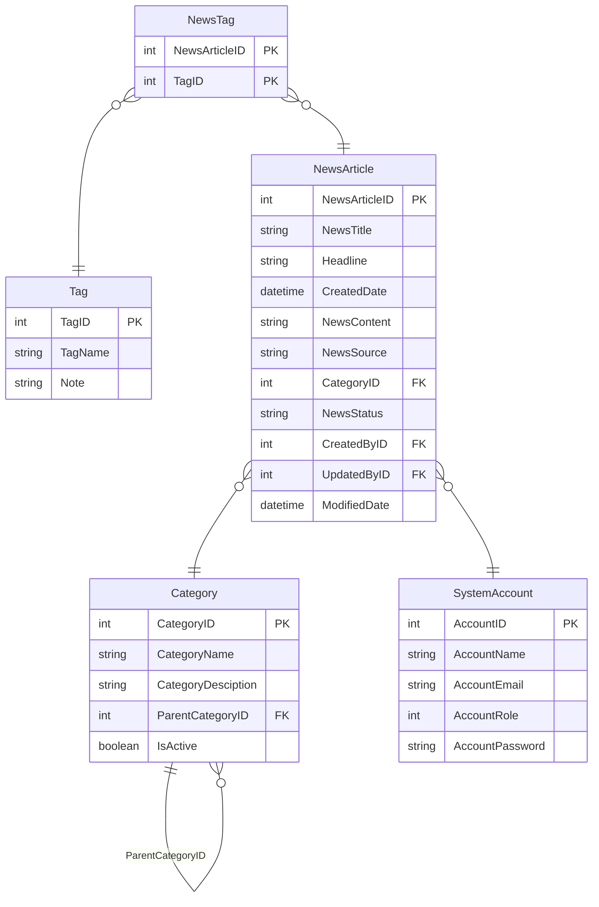

logo: FPT University | logo: Java

## <u>**Assignment 02 SBA301 - Implement CRUD</u> <u>Application with RESTful Web Service and</u> ReactJS**

### **1. Introduction**

A News Management System (NMS) is a software application that helps universities and educational institutions to efficiently manage, organize, and publish news and content to their website and other channels. The NMS typically includes features such as content creation, approval workflow, scheduling, publishing, and analytics. This can help universities to arrange appropriately their news operations, improve communication with students and the wider community, and better engage with their target audience.

Imagine you're a developer of a News Management System named **FUNewsManagementSystem**. To implement a part of this system your tasks include:

* Manage account information.
* Manage news article.

The application has to support adding, viewing, modifying, and removing information - a standardized usage action verb better known as Create, Read, Update, Delete (CRUD) and Search.

*This assignment explores*

* Create a RESTful API using **Spring Boot** 3 with MS SQL Server. An **SQL Server Database** will be created to persist the news data (reading and managing) by **Spring Data JPA**
* React Client sends HTTP requests and retrieve HTTP responses using axios, shows data on the components.

1 | Page

logo: FPT University | logo: Java

## **2. Assignment Objectives**

In this assignment, you will:

* Use the **IntelliJ IDEA** to create Spring Initializr Project (Maybe you can create the Spring Initializr project in <u>https://start.spring.io/</u> then open this project in IntelliJ IDEA.
* Choose **Spring Web** for Building web, including *RESTful*, applications using Spring MVC. Uses Apache Tomcat as the default embedded container. **Spring Data JPA SQL** **for** persisting data in SQL stores with Java Persistence API using Spring Data and Hibernate. **MS SQL Server Driver SQL** - A JDBC and R2DBC driver that provides access to Microsoft SQL Server and Azure SQL Database from any Java application.
* Use in SQL Server Database as a Data Source
* Develop 3-Layer with Repository Architecture to perform CRUD actions using RESTful API with Spring Boot 3.
* React Client sends HTTP requests and retrieve HTTP responses using axios, shows data on the components.
* Apply to validate data type for all fields.
* Run the project and test the FE, BE interactions.

2 | P a g e

## **3. Database Design**

A part of News Management Database:

### Entity Details

**NewsTag**
-  NewsArticleID
-  TagID

**Tag**
-  TagID
- TagName
- Note

**NewsArticle**
-  NewsArticleID
- NewsTitle
- Headline
- CreatedDate
- NewsContent
- NewsSource
- CategoryID
- NewsStatus
- CreatedByID
- UpdatedByID
- ModifiedDate

**Category**
-  CategoryID
- CategoryName
- CategoryDesciption
- ParentCategoryID
- IsActive

**SystemAccount**
-  AccountID
- AccountName
- AccountEmail
- AccountRole
- AccountPassword

- A news article will belong to only one news category (Category).
- An account with staff’s role can create many news articles in this system. (Admin role = 1, Staff role = 2).
- A news article will have many tags and one tag will belong to zero or one news article (News status = active(1)/inactive(0)).
- Category status = active(1)/inactive(0).

**3** | P a g e

## **4. Main Functions**

*   *Do not need authentication to view the news article (news status must be active) in this system.*
*   Member (Staff) authentication by Email and Password.
*   Use Spring Data JPA to create the database.
*   Create **Spring REST API**:
    *   **“Admin”** role: Account management (CRUD, the delete action will delete an account in the case this account is not belong to any news articles (created), if the account is already created any news article, cannot delete.)
    *   **“Staff”** role:
        *   Category management (The delete action will delete an item in the case this item is not belong to any news articles. If the item is already stored in a news article cannot delete.)
        *   News article management (Read, Create, Update and Delete actions).
*   Create Client application (using ReactJS) interactive with **Spring REST API** to perform these functions:
    *   If the user is an **“Admin”** then his/her is allowed
        *   Manage account information.
    *   If user is a **“Staff”**, this staff role is allowed to:
        *   Manage category information.
        *   Manage news article (includes tags)
        *   Manage his/her the profile.
        *   View news history created by him/her.
    *   Note that: News article Management, Account Management, and Category Management: Read, Create, Update, Delete and Search actions. Creating and Updating actions must be performed by popup dialog. Delete action always combines with confirmation.

**4 |** P a g e

## **5. Note**

*   To do your BE program, you must use **Spring REST API** using 3-Layer Architecture.
*   The database named **A2StudentName_ClassCode**
*   Create Spring Initializr Project named **A2StudentName_ClassCode,**
*   Create ReactJS Project named **A2StudentName_ClassCode.**

**5** | P a g e